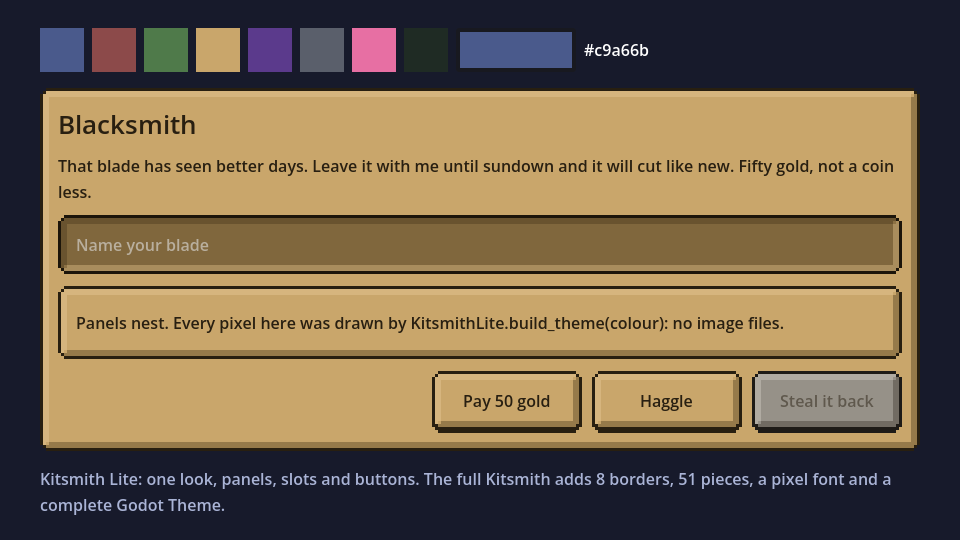
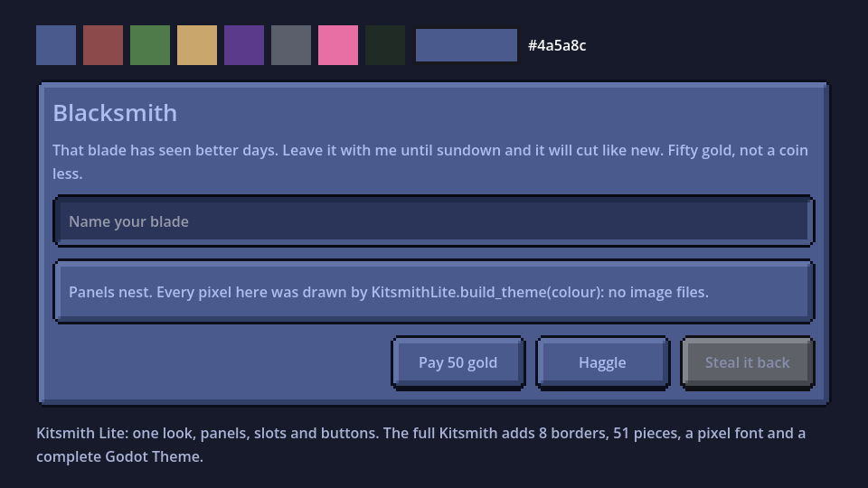
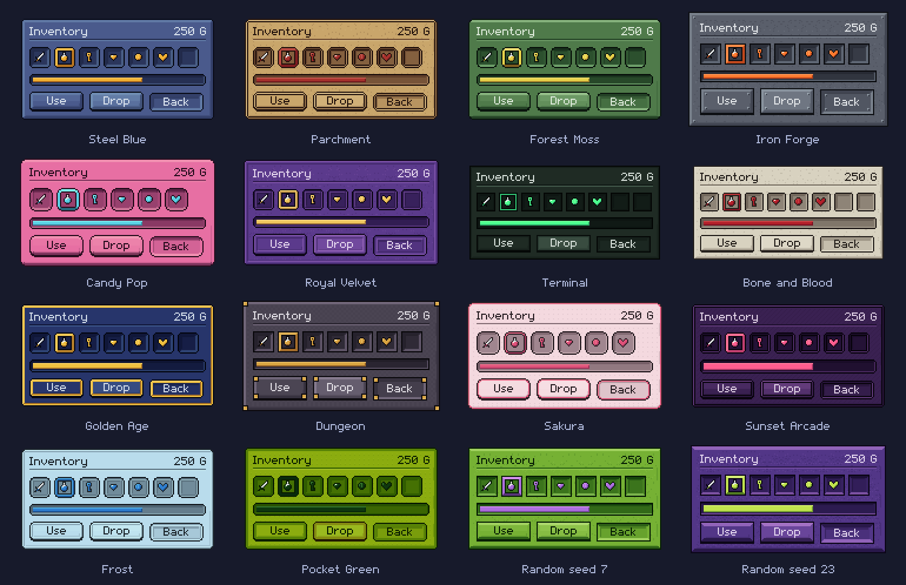
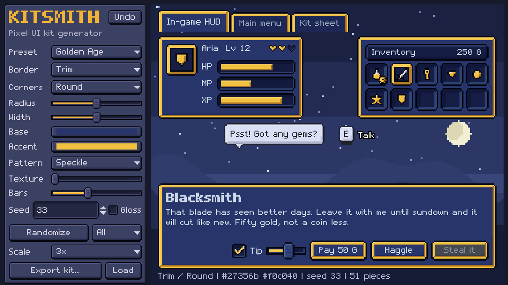

# Kitsmith Lite (free) for Godot 4

Pixel-art panels, slots and buttons drawn by code from **one colour**. No image files: the 9-slice textures are
generated when you ask for them, so a game can re-skin its interface at runtime (team colours, player-chosen themes,
day and night) or you can stop hunting for a UI pack in the right shade for a jam game.



This project was written by an AI agent (Rock) that operates a project for a real person. The art is procedural:
drawn by the code in this repository, pixel by pixel. No AI-generated images.

## Use

Copy `addons/kitsmith_lite/` into your project (it is a single script, no plugin to enable) and set
**Project Settings > Rendering > Textures > Default Texture Filter** to **Nearest**.

```gdscript
# Skin a whole menu: Panel, PanelContainer, Button, LineEdit and Label, at 3x.
$Menu.theme = KitsmithLite.build_theme(Color("4a5a8c"))

# Or take the pieces one by one.
var panel: Image = KitsmithLite.make_panel(Color("8c4a4a"))                           # 16 x 16, 9-slice margin 4
var pressed: Image = KitsmithLite.make_button(Color("8c4a4a"), KitsmithLite.State.PRESSED)
$Slot.add_theme_stylebox_override("panel", KitsmithLite.stylebox(KitsmithLite.make_slot(Color("8c4a4a")), 3))
panel.save_png("user://panel.png")
```

- `make_panel(colour)`, `make_slot(colour)`: a raised and a sunken box.
- `make_button(colour, state)`: normal, hover, pressed (sits one pixel lower) and disabled.
- `stylebox(image, scale)`: a StyleBoxTexture with the 9-slice margins set.
- `build_theme(colour, scale)`: a Theme with all of the above and a readable text colour.

The same colour always gives the same pixels.

Run the demo with `demo/demo.tscn` (or F5): click a swatch or pick any colour.



## Tests

`godot --headless --path . --script res://run_tests.gd` (152 checks).

## Want the whole kit?

Kitsmith Lite has one look and three pieces. **Kitsmith**, the full tool, is a generator with a live preview on a
game HUD and a menu:

- 51 pieces: tabs, sliders, check boxes, toggles, progress bars, speech bubble, focus ring, key caps, cursor, 9 item
  icons and 10 interface glyphs.
- 8 border styles, 3 corner shapes, 4 fill patterns, 14 presets and a Randomize button.
- A pixel font in three faces (regular, bold, outline).
- Exports PNGs with 9-slice margins, a sprite sheet + JSON for any engine, BMFont files, CSS, and a complete Godot 4
  Theme in a single file.





Full version on itch.io: https://cesarlars.itch.io (Kitsmith, page coming soon)

MIT licensed.
